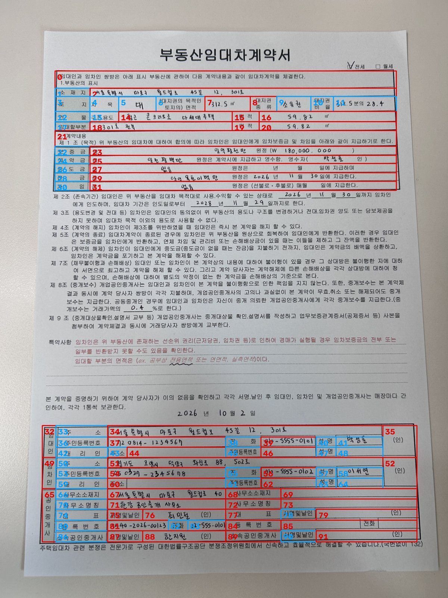
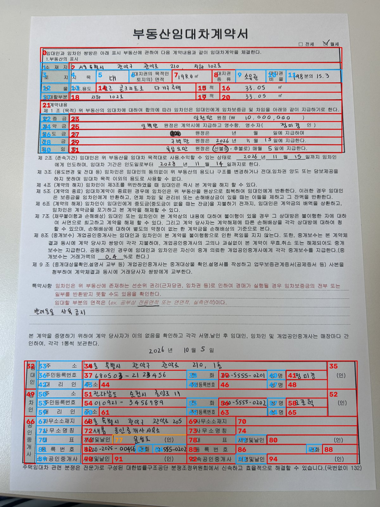
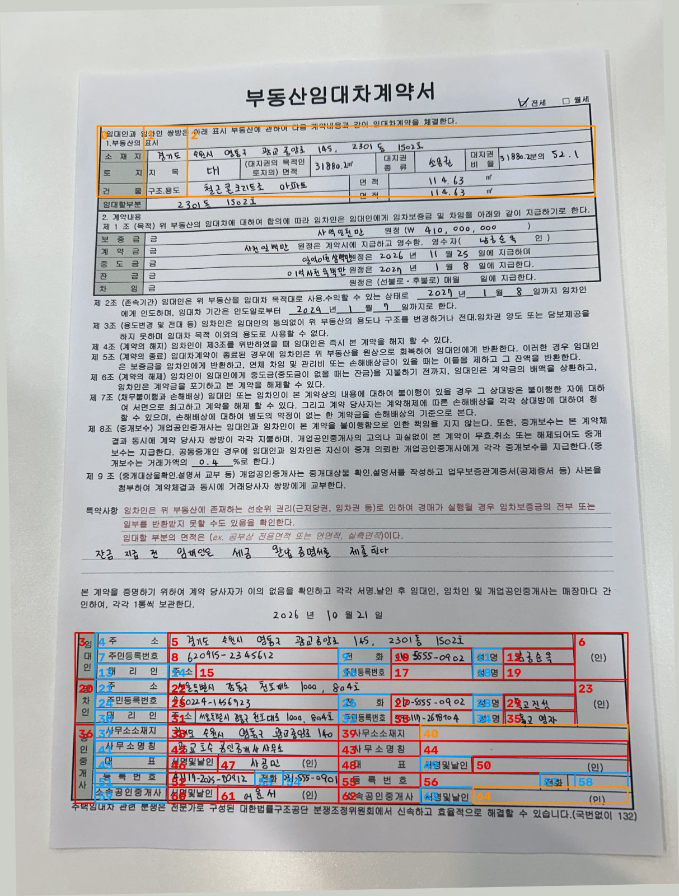

# 대표 성공 사례 (OpenCV Grid + Spanning Reconstruction)

- 이미지: sample.jpg (휴대폰 촬영 임대차계약서, 3000x4000)
- 평가: dahye 공통 evaluator(evaluate.py), sample.jpg_gt.json (GT 95셀), 예측 = cells_original.json (원본 좌표)
- 전체 결과 (IoU 0.5): Precision 90.7% / Recall 82.1% / F1 86.2%

## S1. 세로 병합 셀 복원
- 상황: 하단 서명 표의 "임대인·임차인·공인중개사" 칸과 "(인)" 칸은 여러 행이 세로로 합쳐진 셀
- 결과: primitive 격자 3~5칸을 하나의 merged 셀로 정확히 복원
- 근거 (IoU): 임차인 칸 id 48 (3행 병합) 0.94 / (인) 칸 id 35 (3행) 0.94 / 공인중개사 칸 id 64 (5행) 0.86 / 임대인 칸 id 32 (3행) 0.84
- 그림: 

## S2. 가로 병합 셀 복원
- 상황: 상단 표의 값 칸은 위 행의 열 구분선 때문에 격자상 여러 칸으로 쪼개져 있음
- 결과: 내부 경계가 없는 칸을 Union-Find로 묶어 실제 칸 하나로 복원
- 근거 (IoU): "4층 401호 전체" id 18 (4칸 병합) 0.91 / "철근콘크리트 7조·공동주택" id 14 (3칸) 0.85 / 임대할부분 면적 id 20 (4칸) 0.84 / 제1조 안내문 id 0 (11칸) 0.80
- 그림: 

## S3. 병합 복원의 효과 (Ablation)
| 방법 (IoU 0.5) | Precision | Recall | F1 | Merged Recall |
|---|---|---|---|---|
| Grid only (cells_primitive) | 28.1% | 68.4% | 39.9% | 40.0% |
| Grid + Spanning Recon (cells) | 90.7% | 82.1% | 86.2% | 77.8% |
- 해석: 격자만 쓰면 병합 셀이 잘게 쪼개져 FP가 166개 → 병합 복원 후 8개로 감소
- 그림: 

## S4. 촬영본 자동 전처리
- 상황: 휴대폰 촬영본, 약 1° 기울어짐, 본문에 밑줄·서명선 다수
- 결과: 기울기 -1.06° 자동 보정 (보정 후 잔여 0.00°), 표 2개 자동 분리, 표에 붙지 않은 본문 밑줄은 grid에서 제외
- 근거: report.json (rotation_deg, deskew.residual_deg), 자동 검증 7개 항목 모두 0건
- 그림: 

---

# 공통 10장 대표 성공 사례

- 입력: tail 공통 10장 (`data/common10/`), 실행: `python Task_10_Renewal.py` (Task_0930.py 그대로)
- 근거: `output/common10/<이미지명>/report.json`, tail GT ROI 와의 비교 `output/common10/handoff_tail/field_cell_match.csv`
- 전체 정리: `docs/07_common10_results.md`

## S5. sample_1 — 상·하단 표 전체 복원, 자동 검증 0건
- 결과: 표 2개 (11x11 / 11x13), 최종 셀 92개 (general 44 / merged 48), status `ok`
- 근거: tail 6개 필드 모두 한 행 높이의 셀로 매칭 (GT 대비 셀 높이 0.87~1.0배). 임대인 성명 id 41 IoU 0.61, 임차인 성명 id 58 IoU 0.71
- 그림: 

## S6. sample_2 — 같은 양식 반복 시 셀 id 가 안정적
- 결과: 표 2개 (11x11 / 11x15), 셀 95개 (general 42 / merged 53), status `check` (경계 누락 오판 의심 1건, 결과에는 영향 없음)
- 근거: 소재지 id 2 / 보증금 id 23 / 계약금 id 25 / 임대인 성명 id 41 / 임차인 성명 id 58 로 sample_1 과 같은 id. 임대인·임차인 성명 IoU 0.91 / 0.94
- 의미: 같은 양식이 정면에 가깝게 찍히면 셀 번호만으로 필드 위치를 재사용할 수 있음 (sample_4 상단 표도 id 2·23·25·41 동일)
- 그림: 

## S7. sample_8 하단 표 — 기울기 보정 후 원본 좌표 복원이 정확
- 상황: 1.07° 기울어진 촬영본. 셀은 보정본에서 검출하고 원본 좌표로 되돌려 전달
- 결과: 하단 표 11x14 복원. 보정본 bbox 네 꼭짓점을 원본으로 되돌린 quad 가 tail GT quad 와 수 px 이내로 일치
  - 임대인 성명: 검출 `[[2242,2943],[2569,2949],[2568,3020],[2241,3014]]` / GT `[[2235,2942],[2557,2948],[2559,3020],[2237,3013]]`
  - 임대인·임차인 성명 IoU 0.92 / 0.94
- 의미: 원본 좌표 / 보정본 좌표 구분과 변환이 맞게 동작함 (상단 표는 실패 — 03 문서 F7)
- 그림: 
